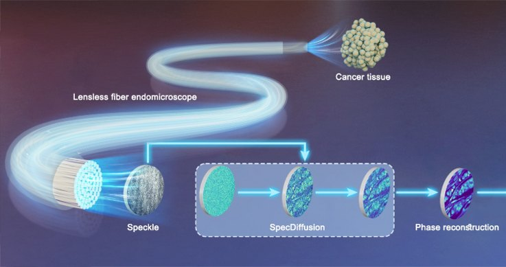
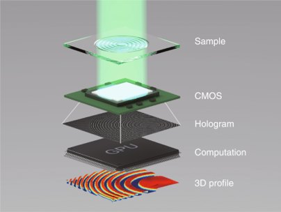
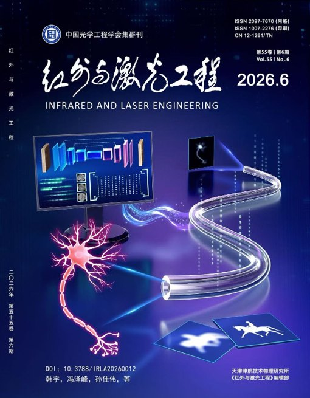

<section class="academic-hero">
  
AI-driven computational optical imaging

  <h1>Jiawei Sun 孙佳伟</h1>
  
Professor, Suzhou Institute of Biomedical Engineering and Technology, Chinese Academy of Sciences

  
Deputy Director of the Jiangsu Provincial Key Laboratory for Advanced Theranostics and Medical Instrumentation

  
AI-driven computational optical imaging for lensless fiber endoscopy and label-free quantitative phase microscopy.

  

    <a href="/research/">Research</a>
    <a href="/publications/">Publications</a>
    <a href="/team-recruiting/">Open Positions</a>
    <a href="mailto:sunjiawei@sibet.ac.cn">Email</a>
  

</section>

## Biography | 个人简介

<h3>English</h3>

I am a <strong>Professor at the Suzhou Institute of Biomedical Engineering and Technology (SIBET), Chinese Academy of Sciences (CAS)</strong>, and <strong>Deputy Director of the Jiangsu Provincial Key Laboratory for Advanced Theranostics and Medical Instrumentation</strong>. My research develops computational optical imaging systems that combine optical physics, fiber photonics, and artificial intelligence for lensless fiber endomicroscopy, multimode fiber imaging, quantitative phase imaging, and 3D optical microscopy.

Before joining SIBET, I was a Young Investigator at the <strong>Shanghai AI Laboratory</strong> and a Research Associate/PostDoc at <strong>TU Dresden</strong>. I received my Ph.D. with the highest distinction (<strong>summa cum laude</strong>) from Dresden University of Technology, advised by Prof. Juergen W. Czarske. I was selected for the <strong>NSFC Excellent Young Scientist Fund (Overseas)</strong> and the <strong>CAS Hundred Talents Program</strong>; my work has also been recognized by the Heinrich Barkhausen Prize, the Siegfried Werth Prize, the University Prize for Measurement Systems Engineering, the SPIE Best Paper Prize, and multiple media highlights.

<h3>中文</h3>

孙佳伟，<strong>中国科学院苏州生物医学工程技术研究所研究员、博士生导师，江苏省先进诊疗技术与装备重点实验室副主任，国家海外高层次青年人才，中国科学院百人计划入选者，国家重点研发计划重点专项评审专家，江苏省侨联专委会特聘专家</strong>。主要从事无透镜光纤显微成像、光场调控与智能光子学相关研究，面向微创内窥、数字病理、三维细胞成像和智能光学系统发展新型计算成像方法与装备。

博士以最高荣誉（summa cum laude）毕业于德国德累斯顿工业大学，师从 Prof. Juergen W. Czarske，并留校开展博士后研究。以第一或通讯作者身份发表期刊和会议论文 20 余篇，包括 <em>Light: Science & Applications</em>、<em>Nature Communications</em>、<em>PhotoniX</em>、<em>Optics Letters</em> 等期刊；研究成果受到 <em>MIT Technology Review</em>、EurekAlert、中国光学等媒体报道。长期招收光学、电子信息、生物医学工程、人工智能等方向博士后、研究助理、博士生及硕士生。

## Research at a Glance

<h3>AI-driven Lensless Fiber Endomicroscopy</h3>

Ultra-thin fiber probes, computational reconstruction, and learning-based phase retrieval for minimally invasive biomedical endomicroscopy.

<ul class="paper-links">
  <li><a href="https://doi.org/10.1038/s41377-022-00898-2">Light: Science & Applications 2022</a></li>
  <li><a href="https://link.springer.com/article/10.1186/s43074-024-00133-8">PhotoniX 2024 review</a></li>
  <li><a href="https://doi.org/10.3788/AI.2025.10010">Advanced Imaging 2025</a></li>
  <li><a href="https://doi.org/10.1364/OE.551221">Optics Express 2025</a></li>
</ul>

<h3>Label-free 3D Optical Microscopy / QPI</h3>

Quantitative phase imaging, optical diffraction tomography, and AI-assisted 3D cell imaging for label-free biological measurement.

<ul class="paper-links">
  <li><a href="https://doi.org/10.1038/s41467-023-44280-1">Nature Communications 2024</a></li>
  <li><a href="https://doi.org/10.1038/s41377-023-01145-y">Light: Science & Applications 2023</a></li>
  <li><a href="https://doi.org/10.1364/OL.509772">Optics Letters 2024</a></li>
  <li><a href="https://doi.org/10.1364/BOE.423035">Biomedical Optics Express 2021</a></li>
</ul>

## Selected Publications

1. **Sun J**\*, Wu J, Wu S, Goswami R, Girardo S, Cao L, Guck J, Koukourakis N\*, Czarske J W.\*, "Quantitative phase imaging through an ultra-thin lensless fiber endoscope," *Light: Science & Applications* **11**(1), 204 (2022). [DOI](https://doi.org/10.1038/s41377-022-00898-2)
2. **Sun J**\*, Yang B, Koukourakis N, Guck J, Czarske J W.\*, "AI-driven projection tomography with multicore fibre-optic cell rotation," *Nature Communications* **15**(1), 147 (2024). [DOI](https://doi.org/10.1038/s41467-023-44280-1)
3. **Sun J**, Kuschmierz R, Katz O, Koukourakis N, Czarske J W.\*, "Lensless fiber endomicroscopy in biomedicine," *PhotoniX* **5**(1), 18 (2024). [Link](https://link.springer.com/article/10.1186/s43074-024-00133-8)
4. **Sun J**, Czarske J W.\*, "Compressive holographic sensing simplifies quantitative phase imaging," *Light: Science & Applications* **12**(1), 121 (2023). [DOI](https://doi.org/10.1038/s41377-023-01145-y)
5. **Sun J**, Zhao B\*, Wang D, Wang Z, Zhang J, Koukourakis N, Czarske J W, Li X.\*, "Calibration-free quantitative phase imaging in multi-core fiber endoscopes using end-to-end deep learning," *Optics Letters* **49**(2), 342-345 (2024). [DOI](https://doi.org/10.1364/OL.509772)

[Full publication list](/publications/) · [Google Scholar](https://scholar.google.com/citations?hl=zh-CN&user=WH60dT4AAAAJ)

## Cover Highlights

  <figure>
    
    <figcaption><em>Infrared and Laser Engineering</em>, 2026 cover feature on intelligent fiber imaging.</figcaption>
  </figure>
  <figure>
    
    <figcaption><em>Laser & Optoelectronics Progress</em>, 2024 cover feature on optical-field intelligent imaging.</figcaption>
  </figure>

## News / Updates

<ul class="compact-list">
  <li><strong>Dec 2025</strong> · Appointed Deputy Director of the Jiangsu Provincial Key Laboratory for Advanced Theranostics and Medical Instrumentation.</li>
  <li><strong>2025</strong> · Selected for the CAS Hundred Talents Program.</li>
  <li><strong>2025</strong> · Selected for the NSFC Excellent Young Scientist Fund (Overseas).</li>
  <li><strong>2025</strong> · Light Conference Best Paper Prize.</li>
  <li><strong>Dec 2024</strong> · Joined SIBET, Chinese Academy of Sciences, as Professor.</li>
</ul>

[Full news archive](/news/)

## Recruiting / Contact

We welcome motivated <strong>postdoctoral fellows, PhD/Master students, research assistants, and visiting students</strong> with backgrounds in optics, photonics, electronic information, biomedical engineering, computational imaging, machine learning, or scientific instrumentation.

Interested applicants are encouraged to email a CV, representative work, and a short research-interest statement to <strong><a href="mailto:sunjiawei@sibet.ac.cn">sunjiawei@sibet.ac.cn</a></strong>. International collaborators may also contact <strong><a href="mailto:jiawei.sun@tu-dresden.de">jiawei.sun@tu-dresden.de</a></strong>.

<a href="/team-recruiting/">Team / Recruiting</a> · <a href="https://sibet.cas.cn/sourcedb/zw/yjdw/gjzdrcgc/202506/t20250623_7873668.html">SIBET profile</a> · <a href="https://orcid.org/0000-0001-8663-1556">ORCID</a>

