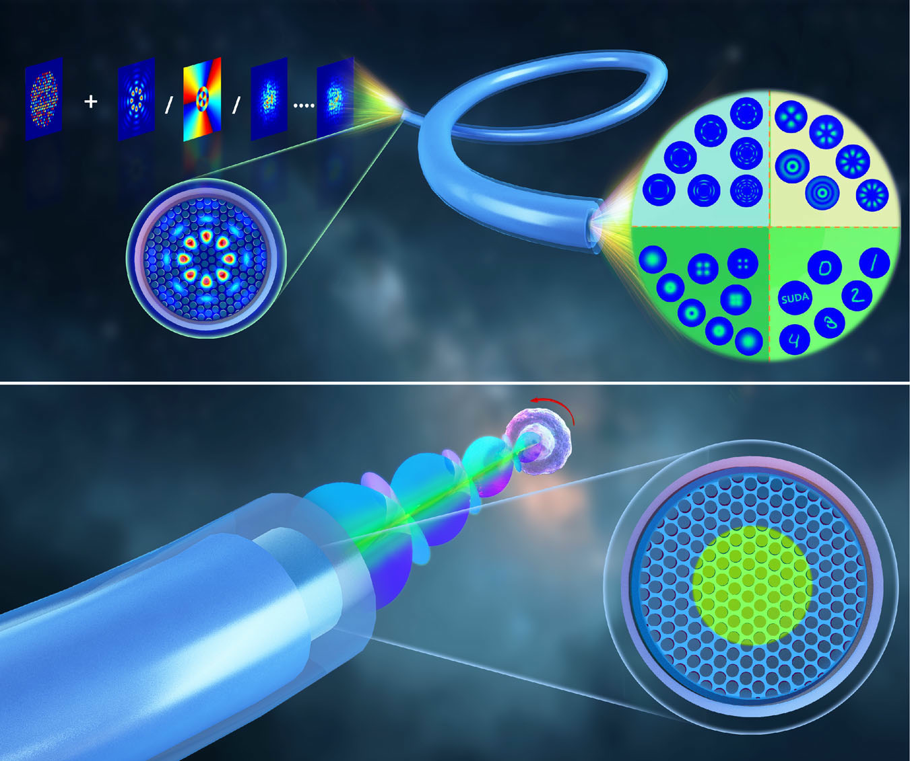
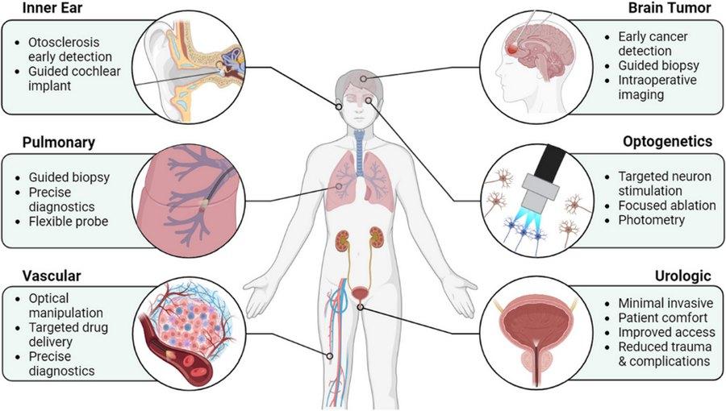
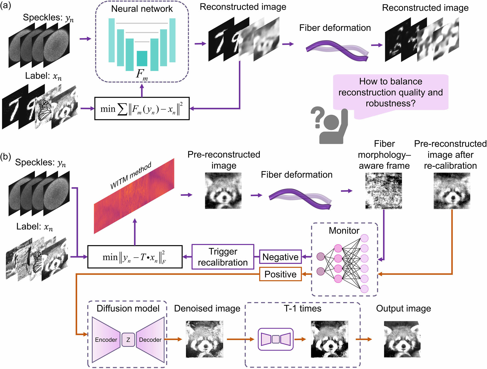
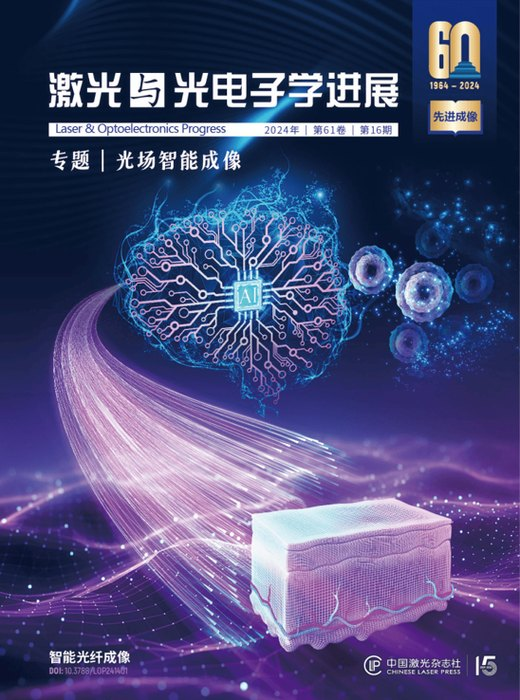

<section class="academic-hero">
  
AI-driven computational optical imaging

  <h1>Jiawei Sun 孙佳伟</h1>
  
Professor, Suzhou Institute of Biomedical Engineering and Technology, Chinese Academy of Sciences

  
Deputy Director of the Jiangsu Provincial Key Laboratory for Advanced Theranostics and Medical Instrumentation

  
AI-driven computational optical imaging for lensless fiber endoscopy and label-free quantitative phase microscopy.

  

    <a href="/research/">Research</a>
    <a href="/publications/">Publications</a>
    <a href="/team-recruiting/">Open Positions</a>
    <a href="mailto:sunjiawei@sibet.ac.cn">Email</a>
  

</section>

## Biography | 个人简介

<h3>English</h3>

I am a <strong>Professor at the Suzhou Institute of Biomedical Engineering and Technology (SIBET), Chinese Academy of Sciences (CAS)</strong>, and <strong>Deputy Director of the Jiangsu Provincial Key Laboratory for Advanced Theranostics and Medical Instrumentation</strong>. My research develops computational optical imaging systems that combine optical physics, fiber photonics, and artificial intelligence for lensless fiber endomicroscopy, multimode fiber imaging, quantitative phase imaging, and 3D optical microscopy. I serve on the editorial board of <em>Scientific Reports</em> and the junior editorial board of <em>BME Frontiers</em>.

Before joining SIBET, I was a Young Investigator at the <strong>Shanghai AI Laboratory</strong> and a Research Associate/PostDoc at <strong>TU Dresden</strong>. I received my Ph.D. with the highest distinction (<strong>summa cum laude</strong>) from Dresden University of Technology, advised by Prof. Juergen W. Czarske. I was selected for the <strong>NSFC Excellent Young Scientist Fund (Overseas)</strong> and the <strong>CAS Hundred Talents Program</strong>; my work has also been recognized by the Heinrich Barkhausen Prize, the Siegfried Werth Prize, the University Prize for Measurement Systems Engineering, the SPIE Best Paper Prize, and multiple media highlights.

<h3>中文</h3>

孙佳伟，<strong>中国科学院苏州生物医学工程技术研究所研究员、博士生导师，江苏省先进诊疗技术与装备重点实验室副主任，国家海外高层次青年人才，中国科学院百人计划入选者，国家重点研发计划重点专项评审专家，江苏省侨联专委会特聘专家</strong>。现任 <em>Scientific Reports</em> 编委、<em>BME Frontiers</em> 青年编委。主要从事无透镜光纤显微成像、光场调控与智能光子学相关研究，面向微创内窥、数字病理、三维细胞成像和智能光学系统发展新型计算成像方法与装备。

博士以最高荣誉（summa cum laude）毕业于德国德累斯顿工业大学，师从 Prof. Juergen W. Czarske，并留校开展博士后研究。以第一或通讯作者身份发表期刊和会议论文 20 余篇，包括 <em>Light: Science & Applications</em>、<em>Nature Communications</em>、<em>PhotoniX</em>、<em>Optics Letters</em> 等期刊；研究成果受到 <em>MIT Technology Review</em>、EurekAlert、中国光学等媒体报道。长期招收光学、电子信息、生物医学工程、人工智能等方向博士后、研究助理、博士生及硕士生。

## Honors & Editorial Service

<h3>Recent Honors</h3>
<ul class="compact-list">
  <li><strong>Monthly Editor's Pick Reviewer</strong>, <em>Light: Science &amp; Applications</em>, August 2026.</li>
  <li><strong>Suzhou Young Scientist</strong>, 2026. <a href="https://www.suzhou.gov.cn/szsrmzf/zwgg/202607/2b0074d528d54616b42490c97a467ccb.shtml">Official announcement</a></li>
  <li><strong>Outstanding Paper Award</strong>, Thematic Forum on Optical Information and Optical Network Technology, 28th Annual Meeting of the China Association for Science and Technology (CAST), 2026. <a href="https://doi.org/10.3788/irla20260012">Awarded review paper</a></li>
  <li><strong>BMEF Journal Contribution Award</strong>, 2025; certificate dated January 30, 2026.</li>
  <li><strong>Light Conference Best Paper Prize</strong>, 2025. <a href="https://sibet.cas.cn/sourcedb/zw/yjdw/yjy/202506/t20250623_7873668.html">SIBET profile</a></li>
</ul>

<h3>Editorial Service</h3>
<ul class="compact-list">
  <li><strong>Editorial Board Member</strong>, <a href="https://www.nature.com/srep/editors"><em>Scientific Reports</em></a>, Nature Portfolio.</li>
  <li><strong>Junior Editorial Board Member</strong>, <a href="https://spj.science.org/page/bmef/editors/"><em>BME Frontiers</em></a>, a Science Partner Journal.</li>
</ul>

<a href="/cv/">Full CV, honors, and academic service</a>

## Research at a Glance

<h3>AI-driven Lensless Fiber Endomicroscopy</h3>

Ultra-thin fiber probes, computational reconstruction, and learning-based phase retrieval for minimally invasive biomedical endomicroscopy.

<ul class="paper-links">
  <li><a href="https://doi.org/10.1038/s41377-022-00898-2">Light: Science & Applications 2022</a></li>
  <li><a href="https://link.springer.com/article/10.1186/s43074-024-00133-8">PhotoniX 2024 review</a></li>
  <li><a href="https://doi.org/10.3788/AI.2025.10010">Advanced Imaging 2025</a></li>
  <li><a href="https://doi.org/10.1364/OE.551221">Optics Express 2025</a></li>
</ul>

<h3>Label-free 3D Optical Microscopy / QPI</h3>

Quantitative phase imaging, optical diffraction tomography, and AI-assisted 3D cell imaging for label-free biological measurement.

<ul class="paper-links">
  <li><a href="https://doi.org/10.1038/s41467-023-44280-1">Nature Communications 2024</a></li>
  <li><a href="https://doi.org/10.1038/s41377-023-01145-y">Light: Science & Applications 2023</a></li>
  <li><a href="https://doi.org/10.1364/OL.509772">Optics Letters 2024</a></li>
  <li><a href="https://doi.org/10.1364/BOE.423035">Biomedical Optics Express 2021</a></li>
</ul>

## Selected Publications

<article class="pub-row" data-doi="10.1038/s41377-022-00898-2">

<h3 class="pub-title"><a href="https://doi.org/10.1038/s41377-022-00898-2" target="_blank" rel="noopener noreferrer">Quantitative phase imaging through an ultra-thin lensless fiber endoscope</a></h3>

<strong>Jiawei Sun</strong>*, Jiachen Wu, Song Wu, Ruchi Goswami, Salvatore Girardo, Liangcai Cao, Jochen Guck, Nektarios Koukourakis*, Juergen W. Czarske*

<em>Light: Science &amp; Applications</em>, 11(1), 204 (2022).

<nav class="pub-links" aria-label="Resources for Quantitative phase imaging through an ultra-thin lensless fiber endoscope"><a href="https://doi.org/10.1038/s41377-022-00898-2" target="_blank" rel="noopener noreferrer">Paper</a><a href="https://github.com/Jiawei-sn/FAST" target="_blank" rel="noopener noreferrer">Code</a></nav>

</article>
<article class="pub-row" data-doi="10.1038/s41467-026-78848-4">

<h3 class="pub-title"><a href="https://doi.org/10.1038/s41467-026-78848-4" target="_blank" rel="noopener noreferrer">Minimally invasive topological light manipulation with lensless fiber endomicroscope</a></h3>

Xiaotan Lu, Zhuoyi Wang, Junan Zhu, Yiyi Hang, Xingyuan Lu*, <strong>Jiawei Sun</strong>*, Yangjian Cai, Chengliang Zhao*

<em>Nature Communications</em> (2026).

<nav class="pub-links" aria-label="Resources for Minimally invasive topological light manipulation with lensless fiber endomicroscope"><a href="https://doi.org/10.1038/s41467-026-78848-4" target="_blank" rel="noopener noreferrer">Paper</a><a href="https://doi.org/10.24433/CO.2375785.v1" target="_blank" rel="noopener noreferrer">Code</a></nav>

</article>
<article class="pub-row" data-doi="10.1038/s41467-023-44280-1">

<h3 class="pub-title"><a href="https://doi.org/10.1038/s41467-023-44280-1" target="_blank" rel="noopener noreferrer">AI-driven projection tomography with multicore fibre-optic cell rotation</a></h3>

<strong>Jiawei Sun</strong>*, Bin Yang, Nektarios Koukourakis, Jochen Guck, Juergen W. Czarske*

<em>Nature Communications</em>, 15(1), 147 (2024).

<nav class="pub-links" aria-label="Resources for AI-driven projection tomography with multicore fibre-optic cell rotation"><a href="https://doi.org/10.1038/s41467-023-44280-1" target="_blank" rel="noopener noreferrer">Paper</a><a href="https://github.com/Jiawei-sn/AI_driven_tomo_master" target="_blank" rel="noopener noreferrer">Code</a><a href="https://doi.org/10.6084/m9.figshare.24523618" target="_blank" rel="noopener noreferrer">Data</a></nav>

</article>
<article class="pub-row" data-doi="10.1186/s43074-024-00133-8">

<h3 class="pub-title"><a href="https://doi.org/10.1186/s43074-024-00133-8" target="_blank" rel="noopener noreferrer">Lensless fiber endomicroscopy in biomedicine</a></h3>

<strong>Jiawei Sun</strong>, Robert Kuschmierz, Ori Katz, Nektarios Koukourakis, Juergen W. Czarske*

<em>PhotoniX</em>, 5(1), 18 (2024).

<nav class="pub-links" aria-label="Resources for Lensless fiber endomicroscopy in biomedicine"><a href="https://doi.org/10.1186/s43074-024-00133-8" target="_blank" rel="noopener noreferrer">Paper</a></nav>

</article>
<article class="pub-row" data-doi="10.1038/s42005-026-02728-y">

<h3 class="pub-title"><a href="https://doi.org/10.1038/s42005-026-02728-y" target="_blank" rel="noopener noreferrer">Physics-informed diffusion enables high-fidelity multimode fiber imaging under dynamic perturbations</a></h3>

Zefeng Feng, Hao Fan, Hu Liu, Tianyu Han, Jiping Wang, Yao Tan, Wei Zhou, Baoteng Xu, Jialin Liu, Jian Zheng, <strong>Jiawei Sun</strong>*, Daxi Xiong*, Xibin Yang*

<em>Communications Physics</em>, 9(1), 324 (2026).

<nav class="pub-links" aria-label="Resources for Physics-informed diffusion enables high-fidelity multimode fiber imaging under dynamic perturbations"><a href="https://doi.org/10.1038/s42005-026-02728-y" target="_blank" rel="noopener noreferrer">Paper</a><a href="https://github.com/fengzefeng/WITM" target="_blank" rel="noopener noreferrer">Code</a></nav>

</article>

[Full publication list](/publications/) · [Google Scholar](https://scholar.google.com/citations?hl=zh-CN&user=WH60dT4AAAAJ)

## Cover Highlights

  <figure>
    
    <figcaption><em>Infrared and Laser Engineering</em>, 2026 cover feature on intelligent fiber imaging.</figcaption>
  </figure>
  <figure>
    
    <figcaption><em>Laser & Optoelectronics Progress</em>, 2024 cover feature on optical-field intelligent imaging.</figcaption>
  </figure>

## News / Updates

<ul class="compact-list">
  <li><strong>Aug 2026</strong> · Monthly Editor's Pick Reviewer, <em>Light: Science &amp; Applications</em>.</li>
  <li><strong>Jul 2026</strong> · Named a Suzhou Young Scientist.</li>
  <li><strong>Jul 2026</strong> · Co-authored review recognized as an Outstanding Paper at the 28th CAST Annual Meeting's thematic forum on optical information and optical network technology.</li>
  <li><strong>Jan 2026</strong> · Certificate issued for the 2025 BMEF Journal Contribution Award.</li>
  <li><strong>Dec 2025</strong> · Appointed Deputy Director of the Jiangsu Provincial Key Laboratory for Advanced Theranostics and Medical Instrumentation.</li>
  <li><strong>2025</strong> · Selected for the CAS Hundred Talents Program.</li>
  <li><strong>2025</strong> · Selected for the NSFC Excellent Young Scientist Fund (Overseas).</li>
  <li><strong>2025</strong> · Light Conference Best Paper Prize.</li>
  <li><strong>Dec 2024</strong> · Joined SIBET, Chinese Academy of Sciences, as Professor.</li>
</ul>

[Full news archive](/news/)

## Recruiting / Contact

We welcome motivated <strong>postdoctoral fellows, PhD/Master students, research assistants, and visiting students</strong> with backgrounds in optics, photonics, electronic information, biomedical engineering, computational imaging, machine learning, or scientific instrumentation.

Interested applicants are encouraged to email a CV, representative work, and a short research-interest statement to <strong><a href="mailto:sunjiawei@sibet.ac.cn">sunjiawei@sibet.ac.cn</a></strong>. International collaborators may also contact <strong><a href="mailto:jiawei.sun@tu-dresden.de">jiawei.sun@tu-dresden.de</a></strong>.

<a href="/team-recruiting/">Team / Recruiting</a> · <a href="https://sibet.cas.cn/sourcedb/zw/yjdw/gjzdrcgc/202506/t20250623_7873668.html">SIBET profile</a> · <a href="https://orcid.org/0000-0001-8663-1556">ORCID</a>

