

Full publication list on Google Scholar: <a href="https://scholar.google.com/citations?user=WH60dT4AAAAJ&amp;hl=zh-CN">https://scholar.google.com/citations?user=WH60dT4AAAAJ&amp;hl=zh-CN</a>

<h2 class="pub-year">Selected publications</h2>
<article class="pub-row" data-doi="10.1038/s41377-022-00898-2">
<a class="pub-art" href="https://doi.org/10.1038/s41377-022-00898-2" target="_blank" rel="noopener noreferrer" aria-label="Open Quantitative phase imaging through an ultra-thin lensless fiber endoscope">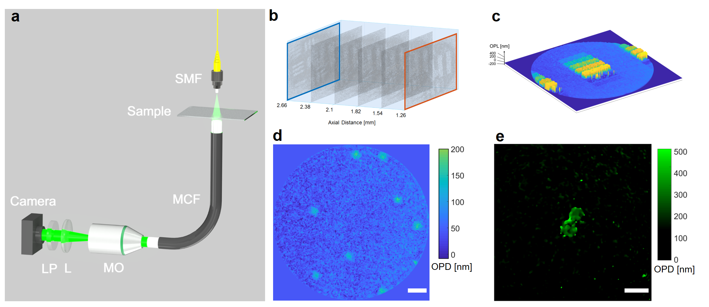</a>

<h3 class="pub-title"><a href="https://doi.org/10.1038/s41377-022-00898-2" target="_blank" rel="noopener noreferrer">Quantitative phase imaging through an ultra-thin lensless fiber endoscope</a></h3>

<strong>Jiawei Sun</strong>*, Jiachen Wu, Song Wu, Ruchi Goswami, Salvatore Girardo, Liangcai Cao, Jochen Guck, Nektarios Koukourakis*, Juergen W. Czarske*

<em>Light: Science &amp; Applications</em>, 11(1), 204 (2022).

<nav class="pub-links" aria-label="Resources for Quantitative phase imaging through an ultra-thin lensless fiber endoscope"><a href="https://doi.org/10.1038/s41377-022-00898-2" target="_blank" rel="noopener noreferrer">Paper</a><a href="https://github.com/Jiawei-sn/FAST" target="_blank" rel="noopener noreferrer">Code</a></nav>

</article>
<article class="pub-row" data-doi="10.1038/s41467-026-78848-4">
<a class="pub-art" href="https://doi.org/10.1038/s41467-026-78848-4" target="_blank" rel="noopener noreferrer" aria-label="Open Minimally invasive topological light manipulation with lensless fiber endomicroscope">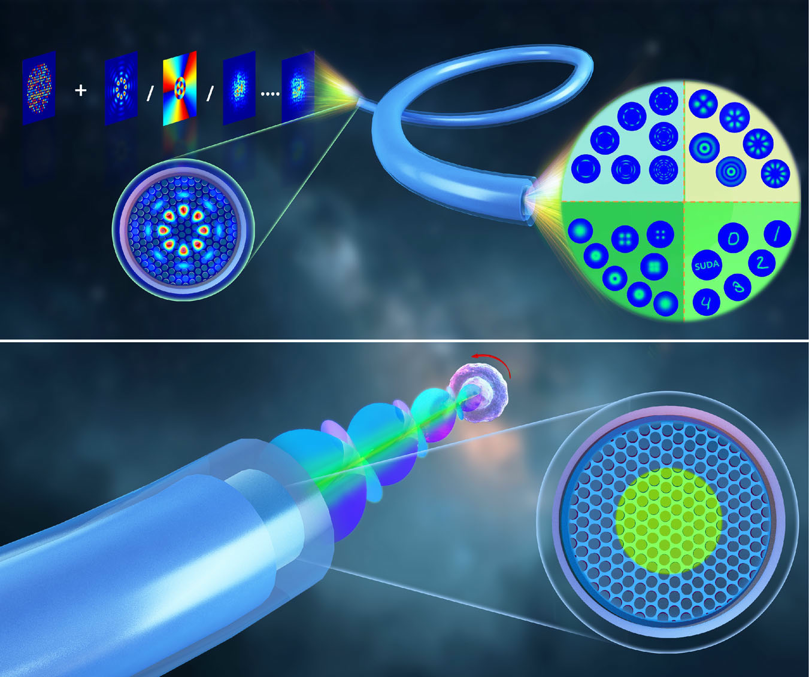</a>

<h3 class="pub-title"><a href="https://doi.org/10.1038/s41467-026-78848-4" target="_blank" rel="noopener noreferrer">Minimally invasive topological light manipulation with lensless fiber endomicroscope</a></h3>

Xiaotan Lu, Zhuoyi Wang, Junan Zhu, Yiyi Hang, Xingyuan Lu*, <strong>Jiawei Sun</strong>*, Yangjian Cai, Chengliang Zhao*

<em>Nature Communications</em> (2026).

<nav class="pub-links" aria-label="Resources for Minimally invasive topological light manipulation with lensless fiber endomicroscope"><a href="https://doi.org/10.1038/s41467-026-78848-4" target="_blank" rel="noopener noreferrer">Paper</a><a href="https://doi.org/10.24433/CO.2375785.v1" target="_blank" rel="noopener noreferrer">Code</a></nav>

</article>
<article class="pub-row" data-doi="10.1038/s41467-023-44280-1">
<a class="pub-art" href="https://doi.org/10.1038/s41467-023-44280-1" target="_blank" rel="noopener noreferrer" aria-label="Open AI-driven projection tomography with multicore fibre-optic cell rotation">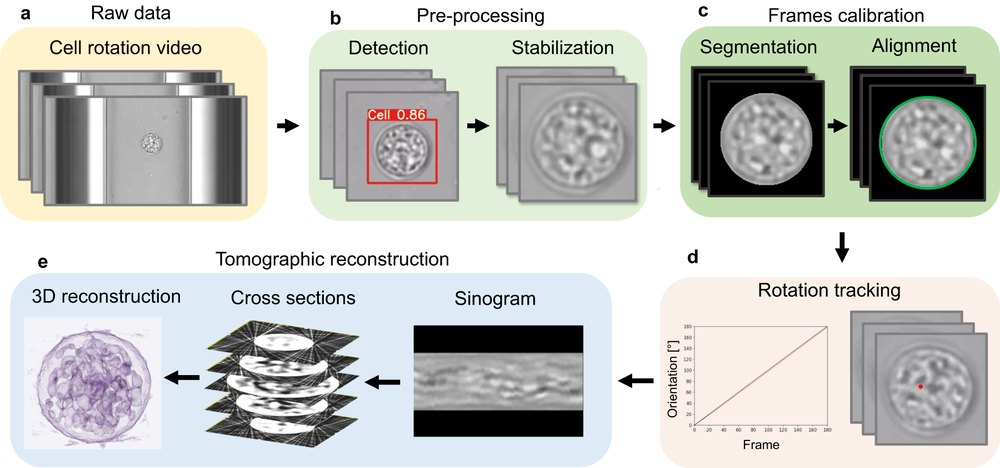</a>

<h3 class="pub-title"><a href="https://doi.org/10.1038/s41467-023-44280-1" target="_blank" rel="noopener noreferrer">AI-driven projection tomography with multicore fibre-optic cell rotation</a></h3>

<strong>Jiawei Sun</strong>*, Bin Yang, Nektarios Koukourakis, Jochen Guck, Juergen W. Czarske*

<em>Nature Communications</em>, 15(1), 147 (2024).

<nav class="pub-links" aria-label="Resources for AI-driven projection tomography with multicore fibre-optic cell rotation"><a href="https://doi.org/10.1038/s41467-023-44280-1" target="_blank" rel="noopener noreferrer">Paper</a><a href="https://github.com/Jiawei-sn/AI_driven_tomo_master" target="_blank" rel="noopener noreferrer">Code</a><a href="https://doi.org/10.6084/m9.figshare.24523618" target="_blank" rel="noopener noreferrer">Data</a></nav>

</article>
<article class="pub-row" data-doi="10.1186/s43074-024-00133-8">
<a class="pub-art" href="https://doi.org/10.1186/s43074-024-00133-8" target="_blank" rel="noopener noreferrer" aria-label="Open Lensless fiber endomicroscopy in biomedicine">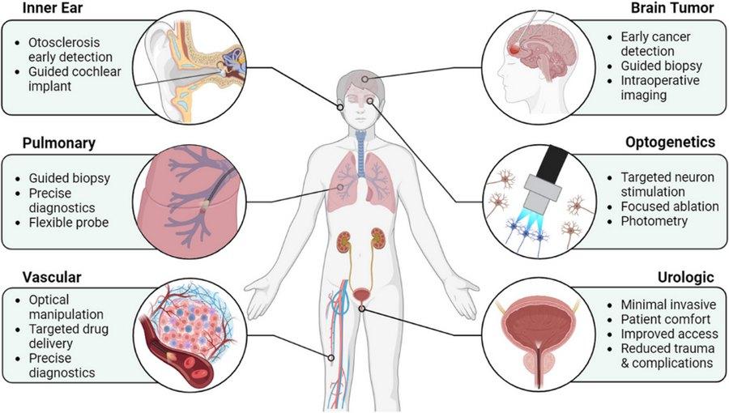</a>

<h3 class="pub-title"><a href="https://doi.org/10.1186/s43074-024-00133-8" target="_blank" rel="noopener noreferrer">Lensless fiber endomicroscopy in biomedicine</a></h3>

<strong>Jiawei Sun</strong>, Robert Kuschmierz, Ori Katz, Nektarios Koukourakis, Juergen W. Czarske*

<em>PhotoniX</em>, 5(1), 18 (2024).

<nav class="pub-links" aria-label="Resources for Lensless fiber endomicroscopy in biomedicine"><a href="https://doi.org/10.1186/s43074-024-00133-8" target="_blank" rel="noopener noreferrer">Paper</a></nav>

</article>
<article class="pub-row" data-doi="10.1038/s42005-026-02728-y">
<a class="pub-art" href="https://doi.org/10.1038/s42005-026-02728-y" target="_blank" rel="noopener noreferrer" aria-label="Open Physics-informed diffusion enables high-fidelity multimode fiber imaging under dynamic perturbations">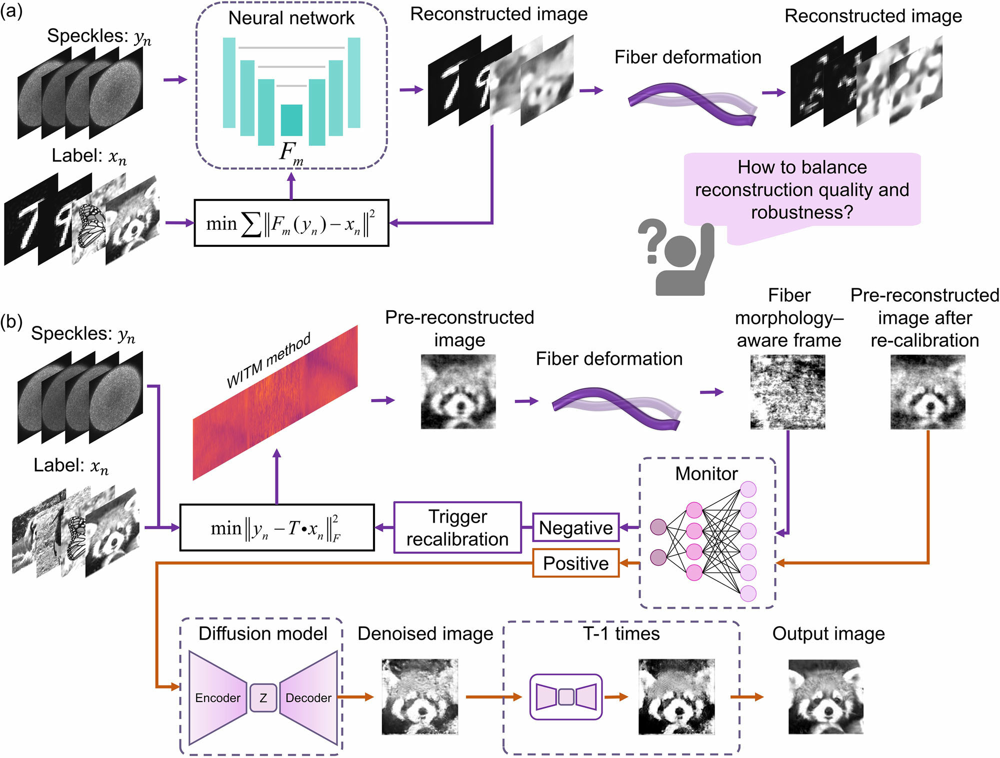</a>

<h3 class="pub-title"><a href="https://doi.org/10.1038/s42005-026-02728-y" target="_blank" rel="noopener noreferrer">Physics-informed diffusion enables high-fidelity multimode fiber imaging under dynamic perturbations</a></h3>

Zefeng Feng, Hao Fan, Hu Liu, Tianyu Han, Jiping Wang, Yao Tan, Wei Zhou, Baoteng Xu, Jialin Liu, Jian Zheng, <strong>Jiawei Sun</strong>*, Daxi Xiong*, Xibin Yang*

<em>Communications Physics</em>, 9(1), 324 (2026).

<nav class="pub-links" aria-label="Resources for Physics-informed diffusion enables high-fidelity multimode fiber imaging under dynamic perturbations"><a href="https://doi.org/10.1038/s42005-026-02728-y" target="_blank" rel="noopener noreferrer">Paper</a><a href="https://github.com/fengzefeng/WITM" target="_blank" rel="noopener noreferrer">Code</a></nav>

</article>
<h2 class="pub-year">2026</h2>
<article class="pub-row" data-doi="10.1038/s41467-026-78848-4">

<h3 class="pub-title"><a href="https://doi.org/10.1038/s41467-026-78848-4" target="_blank" rel="noopener noreferrer">Minimally invasive topological light manipulation with lensless fiber endomicroscope</a></h3>

Xiaotan Lu, Zhuoyi Wang, Junan Zhu, Yiyi Hang, Xingyuan Lu*, <strong>Jiawei Sun</strong>*, Yangjian Cai, Chengliang Zhao*

<em>Nature Communications</em> (2026).

<nav class="pub-links" aria-label="Resources for Minimally invasive topological light manipulation with lensless fiber endomicroscope"><a href="https://doi.org/10.1038/s41467-026-78848-4" target="_blank" rel="noopener noreferrer">Paper</a><a href="https://doi.org/10.24433/CO.2375785.v1" target="_blank" rel="noopener noreferrer">Code</a></nav>

</article>
<article class="pub-row" data-doi="10.1016/j.patcog.2026.115144">
<a class="pub-art" href="https://doi.org/10.1016/j.patcog.2026.115144" target="_blank" rel="noopener noreferrer" aria-label="Open HGMamSurv: a hypergraph mamba network for cancer survival prediction on whole slide images">
Article · 2027<strong>Pattern Recognition</strong>Read paper ↗
</a>

<h3 class="pub-title"><a href="https://doi.org/10.1016/j.patcog.2026.115144" target="_blank" rel="noopener noreferrer">HGMamSurv: a hypergraph mamba network for cancer survival prediction on whole slide images</a></h3>

Saisai Ding, Yihan Deng, <strong>Jiawei Sun</strong>, Jialin Liu, Gang Yuan, Jian Zheng

<em>Pattern Recognition</em>, 183, 115144 (2027).

<nav class="pub-links" aria-label="Resources for HGMamSurv: a hypergraph mamba network for cancer survival prediction on whole slide images"><a href="https://doi.org/10.1016/j.patcog.2026.115144" target="_blank" rel="noopener noreferrer">Paper</a><a href="https://portal.gdc.cancer.gov/" target="_blank" rel="noopener noreferrer">TCGA / GDC</a></nav>

</article>
<article class="pub-row" data-doi="10.34133/bmef.0347">
<a class="pub-art" href="https://doi.org/10.34133/bmef.0347" target="_blank" rel="noopener noreferrer" aria-label="Open Support-Guided Canonicalization Enables Cross-Platform Label-Free Rotational Tomography">
Article · 2026<strong>BME Frontiers</strong>Read paper ↗
</a>

<h3 class="pub-title"><a href="https://doi.org/10.34133/bmef.0347" target="_blank" rel="noopener noreferrer">Support-Guided Canonicalization Enables Cross-Platform Label-Free Rotational Tomography</a></h3>

Bin Yang, <strong>Jiawei Sun</strong>, David Krause, Mariana Medina-Sánchez, Juergen W. Czarske, Nektarios Koukourakis

<em>BME Frontiers</em>, bmef.0347 (2026).

<nav class="pub-links" aria-label="Resources for Support-Guided Canonicalization Enables Cross-Platform Label-Free Rotational Tomography"><a href="https://doi.org/10.34133/bmef.0347" target="_blank" rel="noopener noreferrer">Paper</a></nav>

</article>
<article class="pub-row" data-doi="10.1038/s42005-026-02728-y">

<h3 class="pub-title"><a href="https://doi.org/10.1038/s42005-026-02728-y" target="_blank" rel="noopener noreferrer">Physics-informed diffusion enables high-fidelity multimode fiber imaging under dynamic perturbations</a></h3>

Zefeng Feng, Hao Fan, Hu Liu, Tianyu Han, Jiping Wang, Yao Tan, Wei Zhou, Baoteng Xu, Jialin Liu, Jian Zheng, <strong>Jiawei Sun</strong>*, Daxi Xiong*, Xibin Yang*

<em>Communications Physics</em>, 9(1), 324 (2026).

<nav class="pub-links" aria-label="Resources for Physics-informed diffusion enables high-fidelity multimode fiber imaging under dynamic perturbations"><a href="https://doi.org/10.1038/s42005-026-02728-y" target="_blank" rel="noopener noreferrer">Paper</a><a href="https://github.com/fengzefeng/WITM" target="_blank" rel="noopener noreferrer">Code</a></nav>

</article>
<article class="pub-row" data-doi="10.1364/oe.586529">
<a class="pub-art" href="https://doi.org/10.1364/oe.586529" target="_blank" rel="noopener noreferrer" aria-label="Open Single-shot dual-modality quantitative phase and polarization microscopy">
Article · 2026<strong>Optics Express</strong>Read paper ↗
</a>

<h3 class="pub-title"><a href="https://doi.org/10.1364/oe.586529" target="_blank" rel="noopener noreferrer">Single-shot dual-modality quantitative phase and polarization microscopy</a></h3>

Shangkun Zhang, Hu Liu, Wei Zhou, Linbo Wang, Yao Tan, Baoteng Xu, <strong>Jiawei Sun</strong>, Jialin Liu*, Xibin Yang*

<em>Optics Express</em>, 34(5), 7401-7414 (2026).

<nav class="pub-links" aria-label="Resources for Single-shot dual-modality quantitative phase and polarization microscopy"><a href="https://doi.org/10.1364/oe.586529" target="_blank" rel="noopener noreferrer">Paper</a></nav>

</article>
<article class="pub-row" data-doi="10.1364/boe.589052">
<a class="pub-art" href="https://doi.org/10.1364/boe.589052" target="_blank" rel="noopener noreferrer" aria-label="Open Green channel-informed collaborative filtering for high-fidelity laser speckle contrast imaging in dual-display laparoscopy">
Article · 2026<strong>Biomedical Optics Express</strong>Read paper ↗
</a>

<h3 class="pub-title"><a href="https://doi.org/10.1364/boe.589052" target="_blank" rel="noopener noreferrer">Green channel-informed collaborative filtering for high-fidelity laser speckle contrast imaging in dual-display laparoscopy</a></h3>

Yadi Xue, Jialin Liu*, Wei Zhou, Baoteng Xu, <strong>Jiawei Sun</strong>, Xibin Yang*

<em>Biomedical Optics Express</em>, 17(4), 1897-1910 (2026).

<nav class="pub-links" aria-label="Resources for Green channel-informed collaborative filtering for high-fidelity laser speckle contrast imaging in dual-display laparoscopy"><a href="https://doi.org/10.1364/boe.589052" target="_blank" rel="noopener noreferrer">Paper</a></nav>

</article>
<article class="pub-row" data-doi="10.3788/irla20260012">
<a class="pub-art" href="https://doi.org/10.3788/irla20260012" target="_blank" rel="noopener noreferrer" aria-label="Open 多模光纤计算成像：智能融合及前沿进展(封面文章·特邀)">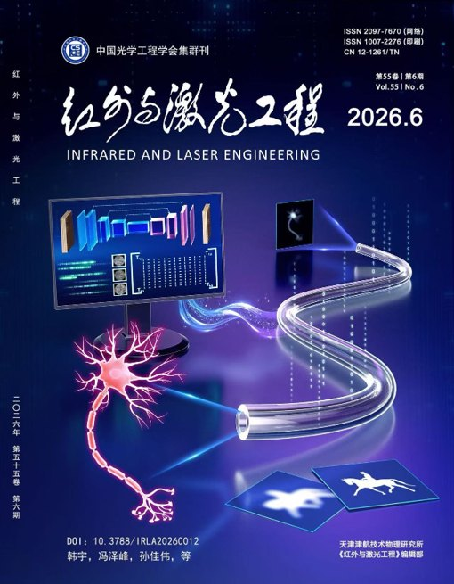</a>

<h3 class="pub-title"><a href="https://doi.org/10.3788/irla20260012" target="_blank" rel="noopener noreferrer">多模光纤计算成像：智能融合及前沿进展(封面文章·特邀)</a></h3>

韩宇†, 冯泽峰†, <strong>孙佳伟</strong>*, 杨西斌*

<em>红外与激光工程</em>, 55(6), 20260012 (2026).

<nav class="pub-links" aria-label="Resources for 多模光纤计算成像：智能融合及前沿进展(封面文章·特邀)"><a href="https://doi.org/10.3788/irla20260012" target="_blank" rel="noopener noreferrer">Paper</a></nav>

</article>
<h2 class="pub-year">2025</h2>
<article class="pub-row" data-doi="10.1364/oe.546689">
<a class="pub-art" href="https://doi.org/10.1364/oe.546689" target="_blank" rel="noopener noreferrer" aria-label="Open High-fidelity image reconstruction in multimode fiber imaging through the MITM-Unet framework">
Article · 2025<strong>Optics Express</strong>Read paper ↗
</a>

<h3 class="pub-title"><a href="https://doi.org/10.1364/oe.546689" target="_blank" rel="noopener noreferrer">High-fidelity image reconstruction in multimode fiber imaging through the MITM-Unet framework</a></h3>

Zefeng Feng†, Zengqi Yue†, Wei Zhou, Baoteng Xu, Jialin Liu, <strong>Jiawei Sun</strong>, Daxi Xiong*, Xibin Yang*

<em>Optics Express</em>, 33(3), 5866-5876 (2025).

<nav class="pub-links" aria-label="Resources for High-fidelity image reconstruction in multimode fiber imaging through the MITM-Unet framework"><a href="https://doi.org/10.1364/oe.546689" target="_blank" rel="noopener noreferrer">Paper</a></nav>

</article>
<article class="pub-row" data-doi="10.1364/oe.551221">
<a class="pub-art" href="https://doi.org/10.1364/oe.551221" target="_blank" rel="noopener noreferrer" aria-label="Open Lensless fiber endomicroscopic phase imaging using a physical model-driven neural network">
Article · 2025<strong>Optics Express</strong>Read paper ↗
</a>

<h3 class="pub-title"><a href="https://doi.org/10.1364/oe.551221" target="_blank" rel="noopener noreferrer">Lensless fiber endomicroscopic phase imaging using a physical model-driven neural network</a></h3>

Yuhang Tang†, Bin Zhao†, Xinyi Ye, <strong>Jiawei Sun</strong>*, Xuelong Li

<em>Optics Express</em>, 33(5), 10951-10964 (2025).

<nav class="pub-links" aria-label="Resources for Lensless fiber endomicroscopic phase imaging using a physical model-driven neural network"><a href="https://doi.org/10.1364/oe.551221" target="_blank" rel="noopener noreferrer">Paper</a></nav>

</article>
<article class="pub-row" data-doi="10.1364/oe.557618">
<a class="pub-art" href="https://doi.org/10.1364/oe.557618" target="_blank" rel="noopener noreferrer" aria-label="Open Structure-guided laser speckle contrast imaging for enhancing microvascular visualization in dual-display laparoscopy">
Article · 2025<strong>Optics Express</strong>Read paper ↗
</a>

<h3 class="pub-title"><a href="https://doi.org/10.1364/oe.557618" target="_blank" rel="noopener noreferrer">Structure-guided laser speckle contrast imaging for enhancing microvascular visualization in dual-display laparoscopy</a></h3>

Yadi Xue, Jialin Liu*, Wei Zhou, Baoteng Xu, <strong>Jiawei Sun</strong>, Xibin Yang*

<em>Optics Express</em>, 33(6), 14170-14183 (2025).

<nav class="pub-links" aria-label="Resources for Structure-guided laser speckle contrast imaging for enhancing microvascular visualization in dual-display laparoscopy"><a href="https://doi.org/10.1364/oe.557618" target="_blank" rel="noopener noreferrer">Paper</a></nav>

</article>
<article class="pub-row" data-doi="10.3788/col202523.121203">
<a class="pub-art" href="https://doi.org/10.3788/col202523.121203" target="_blank" rel="noopener noreferrer" aria-label="Open Learning-based cross-scale wavefront measurement with a hybrid Shack–Hartmann-digital holographic sensor">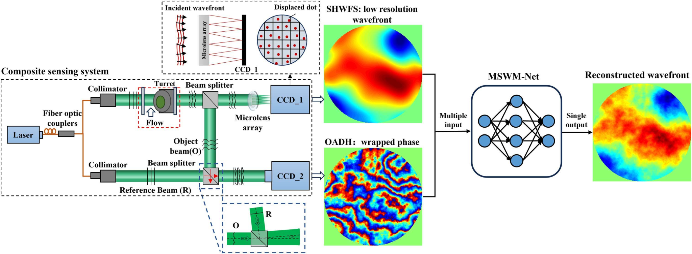</a>

<h3 class="pub-title"><a href="https://doi.org/10.3788/col202523.121203" target="_blank" rel="noopener noreferrer">Learning-based cross-scale wavefront measurement with a hybrid Shack–Hartmann-digital holographic sensor</a></h3>

Ao Li, Zeyu Gao*, <strong>Jiawei Sun</strong>, Yong Chen, Qiang Yuan, Xinlan Ge, Chao Yang, Licheng Zhu, Shiqing Ma, Ling Wei, Shuai Wang, Ping Yang*

<em>Chinese Optics Letters</em>, 23(12), 121203 (2025).

<nav class="pub-links" aria-label="Resources for Learning-based cross-scale wavefront measurement with a hybrid Shack–Hartmann-digital holographic sensor"><a href="https://doi.org/10.3788/col202523.121203" target="_blank" rel="noopener noreferrer">Paper</a></nav>

</article>
<article class="pub-row" data-doi="10.3390/photonics12121187">

<h3 class="pub-title"><a href="https://doi.org/10.3390/photonics12121187" target="_blank" rel="noopener noreferrer">Advancements in Optical Diffraction Neural Networks</a></h3>

Tianyu Han†, <strong>Jiawei Sun</strong>†*, Xibin Yang*

<em>Photonics</em>, 12(12), 1187 (2025).

<nav class="pub-links" aria-label="Resources for Advancements in Optical Diffraction Neural Networks"><a href="https://doi.org/10.3390/photonics12121187" target="_blank" rel="noopener noreferrer">Paper</a></nav>

</article>
<article class="pub-row" data-doi="10.3390/photonics12050464">
<a class="pub-art" href="https://doi.org/10.3390/photonics12050464" target="_blank" rel="noopener noreferrer" aria-label="Open High-Power Lasers and Light–Matter Interactions">
Article · 2025<strong>Photonics</strong>Read paper ↗
</a>

<h3 class="pub-title"><a href="https://doi.org/10.3390/photonics12050464" target="_blank" rel="noopener noreferrer">High-Power Lasers and Light–Matter Interactions</a></h3>

Zhaohong Liu*, Sensen Li, <strong>Jiawei Sun</strong>*

<em>Photonics</em>, 12(5), 464 (2025).

<nav class="pub-links" aria-label="Resources for High-Power Lasers and Light–Matter Interactions"><a href="https://doi.org/10.3390/photonics12050464" target="_blank" rel="noopener noreferrer">Paper</a></nav>

</article>
<article class="pub-row" data-doi="10.3788/ai.2025.10010">
<a class="pub-art" href="https://doi.org/10.3788/ai.2025.10010" target="_blank" rel="noopener noreferrer" aria-label="Open Diffusion-driven lensless fiber endomicroscopic quantitative phase imaging toward digital pathology">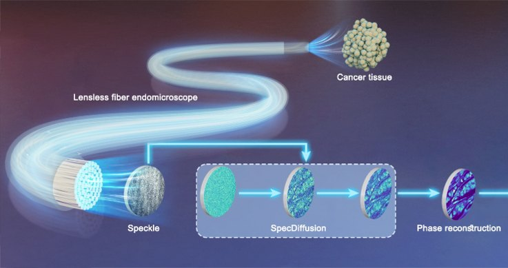</a>

<h3 class="pub-title"><a href="https://doi.org/10.3788/ai.2025.10010" target="_blank" rel="noopener noreferrer">Diffusion-driven lensless fiber endomicroscopic quantitative phase imaging toward digital pathology</a></h3>

Zhaoqing Chen, <strong>Jiawei Sun</strong>*, Xibin Yang, Xinyi Ye, Bin Zhao, Xuelong Li, Juergen W. Czarske

<em>Advanced Imaging</em>, 2(4), 041003 (2025).

<nav class="pub-links" aria-label="Resources for Diffusion-driven lensless fiber endomicroscopic quantitative phase imaging toward digital pathology"><a href="https://doi.org/10.3788/ai.2025.10010" target="_blank" rel="noopener noreferrer">Paper</a></nav>

</article>
<h2 class="pub-year">2024</h2>
<article class="pub-row" data-doi="10.1038/s41467-023-44280-1">

<h3 class="pub-title"><a href="https://doi.org/10.1038/s41467-023-44280-1" target="_blank" rel="noopener noreferrer">AI-driven projection tomography with multicore fibre-optic cell rotation</a></h3>

<strong>Jiawei Sun</strong>*, Bin Yang, Nektarios Koukourakis, Jochen Guck, Juergen W. Czarske*

<em>Nature Communications</em>, 15(1), 147 (2024).

<nav class="pub-links" aria-label="Resources for AI-driven projection tomography with multicore fibre-optic cell rotation"><a href="https://doi.org/10.1038/s41467-023-44280-1" target="_blank" rel="noopener noreferrer">Paper</a><a href="https://github.com/Jiawei-sn/AI_driven_tomo_master" target="_blank" rel="noopener noreferrer">Code</a><a href="https://doi.org/10.6084/m9.figshare.24523618" target="_blank" rel="noopener noreferrer">Data</a></nav>

</article>
<article class="pub-row" data-doi="10.1186/s43074-024-00133-8">

<h3 class="pub-title"><a href="https://doi.org/10.1186/s43074-024-00133-8" target="_blank" rel="noopener noreferrer">Lensless fiber endomicroscopy in biomedicine</a></h3>

<strong>Jiawei Sun</strong>, Robert Kuschmierz, Ori Katz, Nektarios Koukourakis, Juergen W. Czarske*

<em>PhotoniX</em>, 5(1), 18 (2024).

<nav class="pub-links" aria-label="Resources for Lensless fiber endomicroscopy in biomedicine"><a href="https://doi.org/10.1186/s43074-024-00133-8" target="_blank" rel="noopener noreferrer">Paper</a></nav>

</article>
<article class="pub-row" data-doi="10.1364/ol.509772">

<h3 class="pub-title"><a href="https://doi.org/10.1364/ol.509772" target="_blank" rel="noopener noreferrer">Calibration-free quantitative phase imaging in multi-core fiber endoscopes using end-to-end deep learning</a></h3>

<strong>Jiawei Sun</strong>, Bin Zhao*, Dong Wang, Zhigang Wang, Jie Zhang, Nektarios Koukourakis, Júergen W. Czarske, Xuelong Li*

<em>Optics Letters</em>, 49(2), 342-345 (2024).

<nav class="pub-links" aria-label="Resources for Calibration-free quantitative phase imaging in multi-core fiber endoscopes using end-to-end deep learning"><a href="https://doi.org/10.1364/ol.509772" target="_blank" rel="noopener noreferrer">Paper</a><a href="https://doi.org/10.6084/m9.figshare.24932583" target="_blank" rel="noopener noreferrer">Dataset 1</a><a href="https://doi.org/10.6084/m9.figshare.24932604" target="_blank" rel="noopener noreferrer">Dataset 2</a></nav>

</article>
<article class="pub-row" data-doi="10.3788/lop241401">
<a class="pub-art" href="https://doi.org/10.3788/lop241401" target="_blank" rel="noopener noreferrer" aria-label="Open 深度学习在光纤成像中的应用进展(特邀)">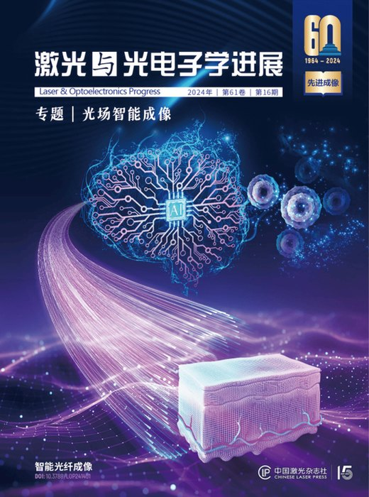</a>

<h3 class="pub-title"><a href="https://doi.org/10.3788/lop241401" target="_blank" rel="noopener noreferrer">深度学习在光纤成像中的应用进展(特邀)</a></h3>

<strong>孙佳伟</strong>, 陈照青, 赵斌*, 李学龙

<em>激光与光电子学进展</em>, 61(16), 1611004 (2024).

<nav class="pub-links" aria-label="Resources for 深度学习在光纤成像中的应用进展(特邀)"><a href="https://doi.org/10.3788/lop241401" target="_blank" rel="noopener noreferrer">Paper</a></nav>

</article>
<h2 class="pub-year">2023 and earlier</h2>
<article class="pub-row" data-doi="10.1038/s41377-023-01145-y">
<a class="pub-art" href="https://doi.org/10.1038/s41377-023-01145-y" target="_blank" rel="noopener noreferrer" aria-label="Open Compressive holographic sensing simplifies quantitative phase imaging">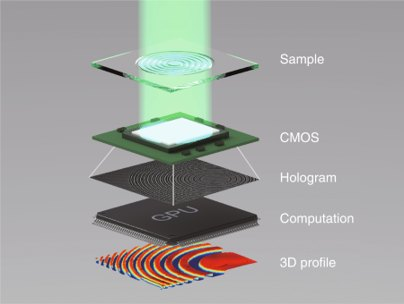</a>

<h3 class="pub-title"><a href="https://doi.org/10.1038/s41377-023-01145-y" target="_blank" rel="noopener noreferrer">Compressive holographic sensing simplifies quantitative phase imaging</a></h3>

<strong>Jiawei Sun</strong>, Juergen W. Czarske*

<em>Light: Science &amp; Applications</em>, 12(1), 121 (2023).

<nav class="pub-links" aria-label="Resources for Compressive holographic sensing simplifies quantitative phase imaging"><a href="https://doi.org/10.1038/s41377-023-01145-y" target="_blank" rel="noopener noreferrer">Paper</a></nav>

</article>
<article class="pub-row" data-doi="10.1038/s41377-022-00898-2">

<h3 class="pub-title"><a href="https://doi.org/10.1038/s41377-022-00898-2" target="_blank" rel="noopener noreferrer">Quantitative phase imaging through an ultra-thin lensless fiber endoscope</a></h3>

<strong>Jiawei Sun</strong>*, Jiachen Wu, Song Wu, Ruchi Goswami, Salvatore Girardo, Liangcai Cao, Jochen Guck, Nektarios Koukourakis*, Juergen W. Czarske*

<em>Light: Science &amp; Applications</em>, 11(1), 204 (2022).

<nav class="pub-links" aria-label="Resources for Quantitative phase imaging through an ultra-thin lensless fiber endoscope"><a href="https://doi.org/10.1038/s41377-022-00898-2" target="_blank" rel="noopener noreferrer">Paper</a><a href="https://github.com/Jiawei-sn/FAST" target="_blank" rel="noopener noreferrer">Code</a></nav>

</article>
<article class="pub-row" data-doi="10.1038/s41598-022-11803-7">
<a class="pub-art" href="https://doi.org/10.1038/s41598-022-11803-7" target="_blank" rel="noopener noreferrer" aria-label="Open Real-time complex light field generation through a multi-core fiber with deep learning">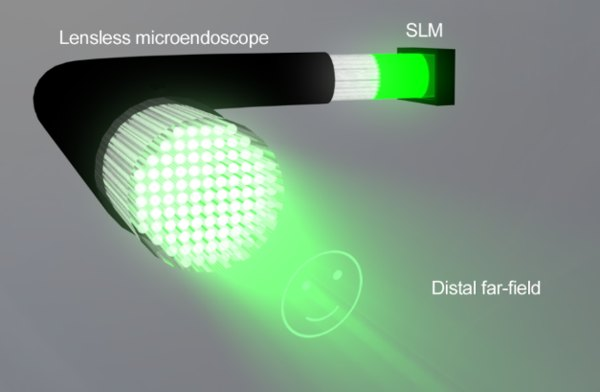</a>

<h3 class="pub-title"><a href="https://doi.org/10.1038/s41598-022-11803-7" target="_blank" rel="noopener noreferrer">Real-time complex light field generation through a multi-core fiber with deep learning</a></h3>

<strong>Jiawei Sun</strong>†*, Jiachen Wu†*, Nektarios Koukourakis, Liangcai Cao, Robert Kuschmierz, Juergen Czarske*

<em>Scientific Reports</em>, 12(1), 7732 (2022).

<nav class="pub-links" aria-label="Resources for Real-time complex light field generation through a multi-core fiber with deep learning"><a href="https://doi.org/10.1038/s41598-022-11803-7" target="_blank" rel="noopener noreferrer">Paper</a><a href="https://github.com/Jiawei-sn/CoreNet" target="_blank" rel="noopener noreferrer">Code</a><a href="https://github.com/Jiawei-sn/CoreNet/blob/main/test_images.zip" target="_blank" rel="noopener noreferrer">Test images</a></nav>

</article>
<article class="pub-row" data-doi="10.1364/oe.503131">

<h3 class="pub-title"><a href="https://doi.org/10.1364/oe.503131" target="_blank" rel="noopener noreferrer">ASF-Transformer: neutralizing the impact of atmospheric turbulence on optical imaging through alternating learning in the spatial and frequency domains</a></h3>

Ziran Zhang, Bin Zhao‡*, Yueting Chen, Zhigang Wang, Dong Wang, <strong>Jiawei Sun</strong>, Jie Zhang, Zhihai Xu, Xuelong Li‡*

<em>Optics Express</em>, 31(22), 37128-37141 (2023).

<nav class="pub-links" aria-label="Resources for ASF-Transformer: neutralizing the impact of atmospheric turbulence on optical imaging through alternating learning in the spatial and frequency domains"><a href="https://doi.org/10.1364/oe.503131" target="_blank" rel="noopener noreferrer">Paper</a><a href="https://github.com/naturezhanghn/ASFTransformer" target="_blank" rel="noopener noreferrer">Code</a></nav>

</article>
<article class="pub-row" data-doi="10.1364/boe.423035">
<a class="pub-art" href="https://doi.org/10.1364/boe.423035" target="_blank" rel="noopener noreferrer" aria-label="Open Rapid computational cell-rotation around arbitrary axes in 3D with multi-core fiber">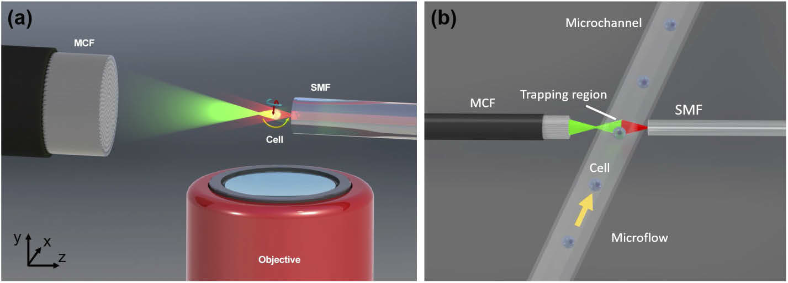</a>

<h3 class="pub-title"><a href="https://doi.org/10.1364/boe.423035" target="_blank" rel="noopener noreferrer">Rapid computational cell-rotation around arbitrary axes in 3D with multi-core fiber</a></h3>

<strong>Jiawei Sun</strong>*, Nektarios Koukourakis, Jochen Guck, Jürgen W. Czarske

<em>Biomedical Optics Express</em>, 12(6), 3423-3437 (2021).

<nav class="pub-links" aria-label="Resources for Rapid computational cell-rotation around arbitrary axes in 3D with multi-core fiber"><a href="https://doi.org/10.1364/boe.423035" target="_blank" rel="noopener noreferrer">Paper</a></nav>

</article>
<article class="pub-row" data-doi="10.3390/app11093949">

<h3 class="pub-title"><a href="https://doi.org/10.3390/app11093949" target="_blank" rel="noopener noreferrer">Complex Wavefront Shaping through a Multi-Core Fiber</a></h3>

<strong>Jiawei Sun</strong>, Nektarios Koukourakis*, Jürgen W. Czarske

<em>Applied Sciences</em>, 11(9), 3949 (2021).

<nav class="pub-links" aria-label="Resources for Complex Wavefront Shaping through a Multi-Core Fiber"><a href="https://doi.org/10.3390/app11093949" target="_blank" rel="noopener noreferrer">Paper</a></nav>

</article>

