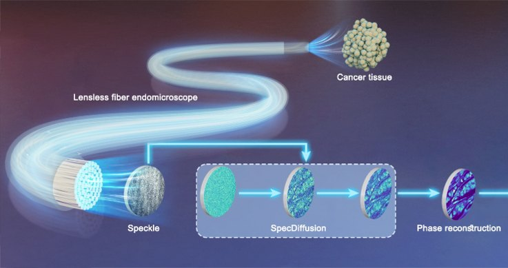
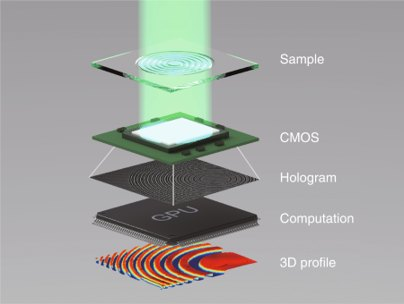
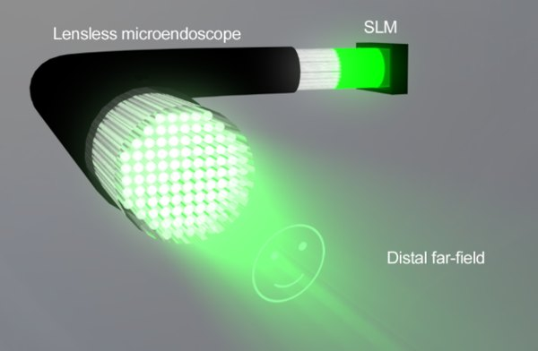
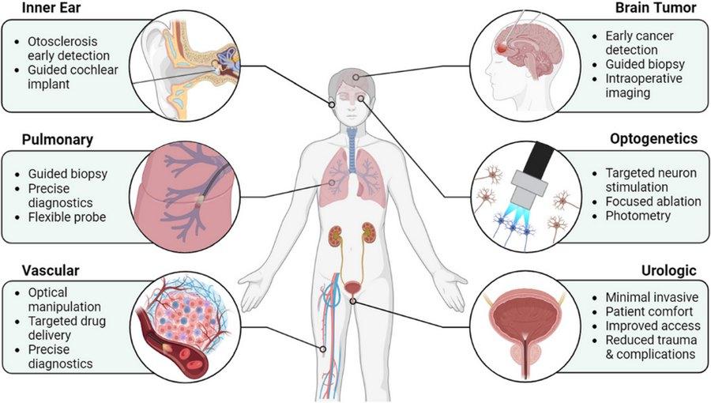
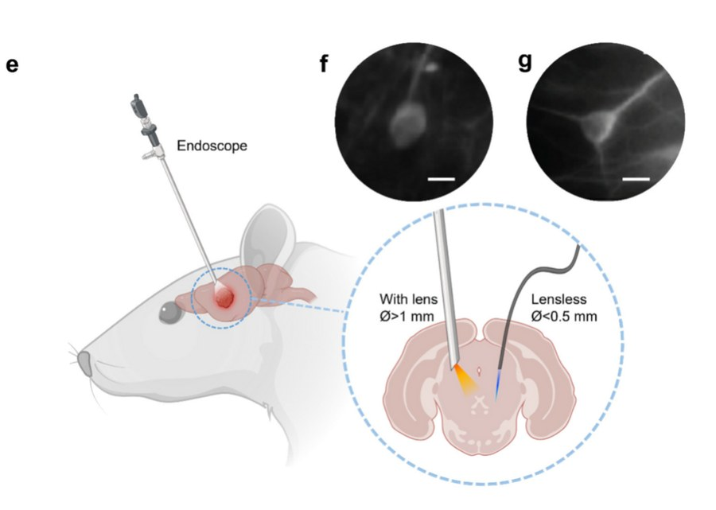
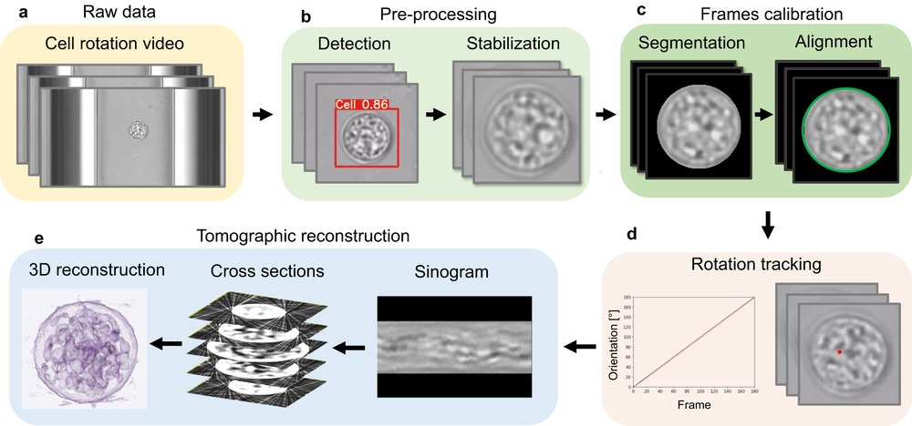
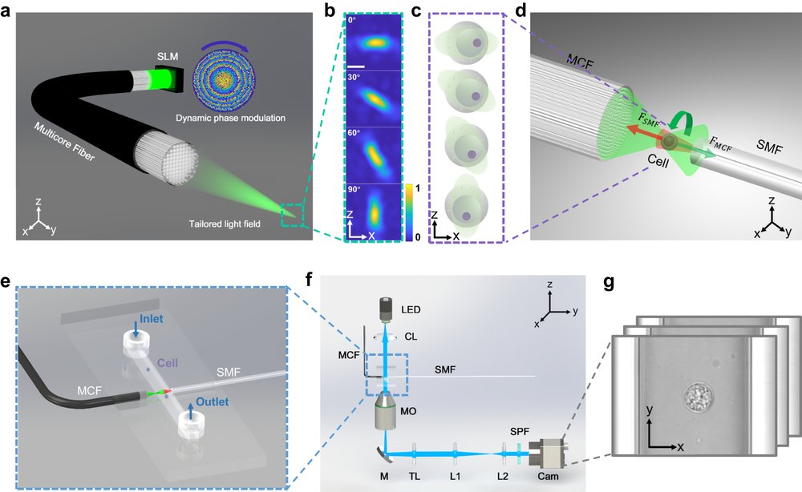
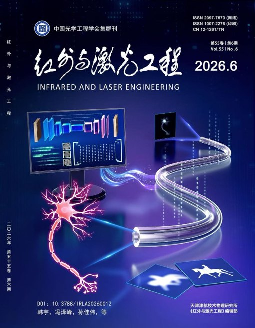

Our research develops **AI-driven computational optical imaging** methods and instruments for biomedical microscopy and endoscopy. We combine fiber optics, quantitative phase imaging, optical diffraction tomography, and learning-based inverse reconstruction to push optical imaging toward thinner probes, richer contrast, and higher-dimensional biological information.

## Research Pillars

<h3>AI-driven Lensless Fiber Endomicroscopy</h3>

We develop ultra-thin lensless fiber probes and computational reconstruction methods for quantitative endomicroscopy. The goal is to turn bare or minimally packaged fiber devices into intelligent imaging probes for biomedical inspection, digital pathology, and minimally invasive diagnostics.

<strong>Representative outputs:</strong>

<ul class="paper-links">
  <li><a href="https://doi.org/10.1038/s41377-022-00898-2">Quantitative phase imaging through an ultra-thin lensless fiber endoscope</a>, <em>Light: Science & Applications</em>, 2022.</li>
  <li><a href="https://link.springer.com/article/10.1186/s43074-024-00133-8">Lensless fiber endomicroscopy in biomedicine</a>, <em>PhotoniX</em>, 2024.</li>
  <li><a href="https://doi.org/10.3788/AI.2025.10010">Diffusion-driven lensless fiber endomicroscopic quantitative phase imaging toward digital pathology</a>, <em>Advanced Imaging</em>, 2025.</li>
  <li><a href="https://doi.org/10.1364/OE.551221">Lensless fiber endomicroscopic phase imaging using a physical model-driven neural network</a>, <em>Optics Express</em>, 2025.</li>
</ul>

<h3>Label-free 3D Optical Microscopy / QPI</h3>

We develop label-free quantitative phase imaging and 3D optical microscopy methods for cells, tissues, and biophysical samples. Current work includes calibration-free QPI, optical diffraction tomography, AI-assisted projection tomography, and compressed holographic sensing.

<strong>Representative outputs:</strong>

<ul class="paper-links">
  <li><a href="https://doi.org/10.1038/s41467-023-44280-1">AI-driven projection tomography with multicore fibre-optic cell rotation</a>, <em>Nature Communications</em>, 2024.</li>
  <li><a href="https://doi.org/10.1038/s41377-023-01145-y">Compressive holographic sensing simplifies quantitative phase imaging</a>, <em>Light: Science & Applications</em>, 2023.</li>
  <li><a href="https://doi.org/10.1364/OL.509772">Calibration-free quantitative phase imaging in multi-core fiber endoscopes using end-to-end deep learning</a>, <em>Optics Letters</em>, 2024.</li>
  <li><a href="https://doi.org/10.1364/BOE.423035">Rapid computational cell-rotation around arbitrary axes in 3D with multi-core fiber</a>, <em>Biomedical Optics Express</em>, 2021.</li>
</ul>

## Lensless Fiber Endomicroscopy

<h3>Why Lensless Fibers?</h3>

Lens-based endoscopes provide valuable optical access, but their distal optics impose a lower bound on probe diameter and mechanical rigidity. Lensless fiber endomicroscopy replaces distal lenses with computational wavefront control and inverse reconstruction, enabling ultra-thin probes that can potentially access delicate anatomical regions, curved lumens, and minimally invasive biomedical settings.

<figure class="research-figure research-figure--medium">
  
  <figcaption>Concept of a lensless multicore-fiber microendoscope, where the distal field is computationally controlled without conventional miniaturized lenses.</figcaption>
</figure>

<h3>Biomedical Applications</h3>

Lensless fiber probes are relevant to deep-tissue optical access, guided biopsy, optogenetics, vascular and urologic imaging, and other settings where probe diameter, flexibility, and working distance matter.

<figure class="research-figure">
  
  <figcaption>Representative biomedical application space for ultra-thin lensless endomicroscopy.</figcaption>
</figure>

<h3>Toward In Vivo QPI</h3>

Our long-term goal is to move quantitative phase imaging from benchtop microscopy toward in vivo and minimally invasive settings. Computational fiber probes can reduce distal hardware while preserving rich optical contrast.

<figure class="research-figure">
  
  <figcaption>Lensless fiber probes can reduce distal probe size while preserving cellular-scale optical contrast.</figcaption>
</figure>

## Label-free 3D Optical Microscopy / QPI

<h3>From Projection Data to Quantitative 3D Structure</h3>

For label-free 3D imaging, we combine optical diffraction tomography, multicore-fiber-enabled cell rotation, robust frame calibration, and AI-assisted reconstruction. This direction targets isotropic-resolution cell tomography and compact computational microscopy systems.

<figure class="research-figure">
  
  <figcaption>AI-assisted tomographic workflow from cell-rotation video to calibrated projections, rotation tracking, cross sections, and 3D reconstruction.</figcaption>
</figure>

<figure class="research-figure">
  
  <figcaption>Multicore-fiber light-field control and optical cell rotation for label-free 3D tomographic imaging.</figcaption>
</figure>

## Cover-paper Highlights

  <figure>
    
    <figcaption><em>Infrared and Laser Engineering</em>, 2026 cover feature on intelligent fiber imaging.</figcaption>
  </figure>
  <figure>
    
    <figcaption><em>Laser & Optoelectronics Progress</em>, 2024 cover feature on optical-field intelligent imaging.</figcaption>
  </figure>

## Current Directions | 当前方向

- **Intelligent lensless fiber endomicroscopy:** computational probes for label-free, minimally invasive, high-resolution biomedical imaging.
- **AI-enabled optical tomography:** projection tomography and optical diffraction tomography with learned reconstruction and physics-aware priors.
- **Quantitative phase imaging:** calibration-free, compressed, and end-to-end reconstruction methods for phase microscopy.
- **Digital pathology and biomedical instrumentation:** translating computational optical imaging methods into robust, deployable research instruments.

## Selected Methods

- Multi-core and multimode fiber imaging
- Quantitative phase imaging and optical diffraction tomography
- Far-field speckle decoding and holographic reconstruction
- Physics-informed neural networks and end-to-end inverse models
- Computational microscopy system design and biomedical validation

## Collaboration

We welcome collaborations in optical imaging, biomedical instrumentation, AI for photonics, digital pathology, and microendoscopic device development. Please contact **[sunjiawei@sibet.ac.cn](mailto:sunjiawei@sibet.ac.cn)** with a short description of the scientific question or instrument challenge.
